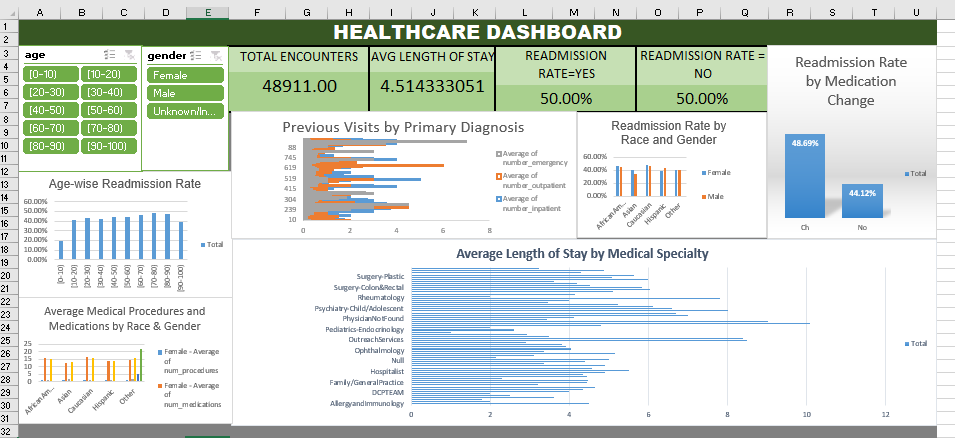

# Hospital Readmissions Analysis

## Project Overview
This project analyzes hospital readmission data using Microsoft Excel to identify patterns and understand factors associated with patient readmissions.

## Objectives
- Analyze hospital readmission rates.
- Explore the relationship between patient demographics and readmissions.
- Examine previous hospital visits and readmission patterns.
- Analyze average length of hospital stay across medical specialties.
- Develop an interactive healthcare dashboard.

## Tools & Technologies
- Microsoft Excel 2016
- Power Query
- Power Pivot
- PivotTables and PivotCharts
- Excel Formulas
- Slicers and Interactive Dashboard

## Data Cleaning
- Cleaned and prepared the dataset using Power Query.
- Checked data types and handled missing or invalid values where applicable.
- Prepared data for analysis using PivotTables.

## Analysis Performed
- Age-wise Readmission Rate
- Average Length of Stay by Medical Specialty
- Readmission Rate by Race and Gender
- Readmission Rate by Medication Change
- Average Medical Procedures and Medications by Race and Gender
- Previous Visits by Primary Diagnosis

## Dashboard Preview

## Project Files
| File | Description |
|---|---|
| Hospital_Readmissions_Analysis.xlsx | Excel workbook containing cleaned data, analysis, PivotTables, PivotCharts and dashboard |
| HA Data.csv | Dataset used for analysis |
| Healthcare_Dashboard.png | Dashboard screenshot |

## Limitations
Some analyses could not be performed because the required information was unavailable or medication indicators did not include exact medication names.

## Conclusion
This project demonstrates the application of Excel-based data cleaning, analysis, visualization and interactive dashboard development to explore hospital readmission patterns.
